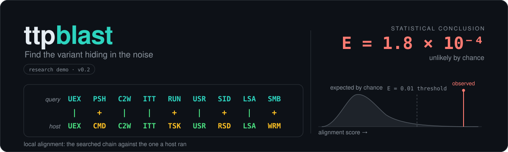
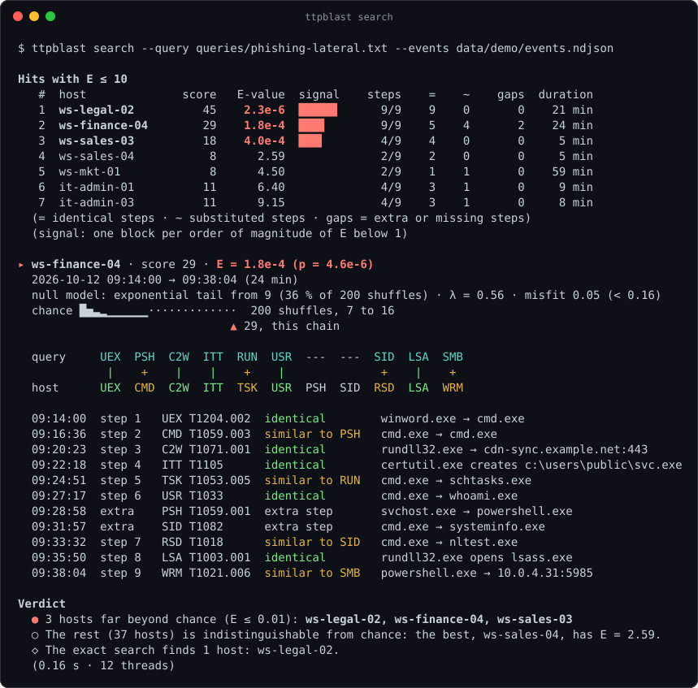
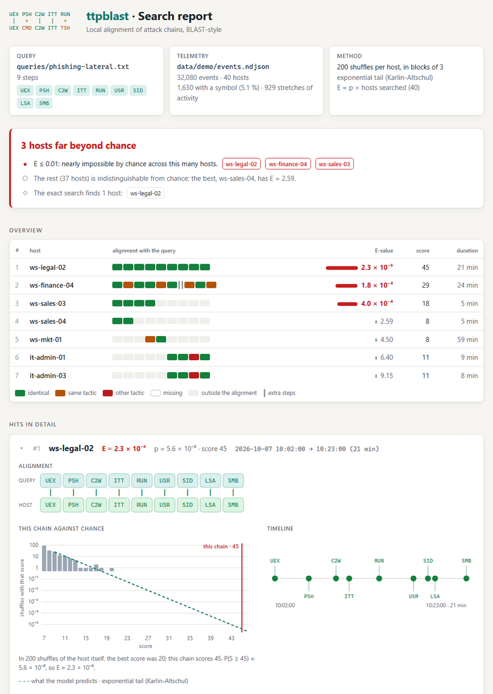

<p align="center">
  
</p>

<p align="center">
  <b>BLAST for endpoint telemetry.</b><br>
  It searches your machines' events for <b>variants</b> of a known attack chain<br>
  and tells you, with an E-value, whether the resemblance is chance.
</p>

<p align="center">
  <a href="https://github.com/Ruby570bocadito/ttpblast/actions/workflows/ci.yml"></a>
  
  
  · <a href="README.md">Español</a>
</p>

**Status: research demo (v0.2).** It works end to end on synthetic telemetry, in English
and Spanish, with an HTML report to share. The scoring matrix is a first version (not
learned from data), calibration on real data is still to be shown, and we already know how
to hide a chain from it: slip ordinary commands between its steps, which `--mask` counters
on the synthetic data. Read [Limitations](#limitations) before trusting an E-value.

## Try it in 30 seconds

```bash
ttpblast demo
```

The demo hides four attack chains in two weeks of made-up telemetry (40 hosts, 32,080
events), looks for them the way an analyst would and grades itself against the truth. This
is what it sees when searching for the chain of a malicious Office document:

<p align="center">
  
</p>

The exact search only finds the identical copy of the chain (ws-legal-02). `ttpblast` also
finds the variant (ws-finance-04: cmd instead of PowerShell, a scheduled task instead of a
Run key, WinRM instead of SMB, and two extra steps) and the chain that was cut short
(ws-sales-03). All three stand well above everything else: the next host has E = 2.59,
which is what chance gives.

## The problem

There are two usual ways to look for an attack chain in telemetry, and neither is good:

- **Exact query** (specific steps, in order). It stops matching as soon as the attacker
  swaps PowerShell for cmd, uses a scheduled task instead of a Run key, or adds one step.
- **Loose query** (some of the steps, in any order). False alarms show up, and there is no
  way to tell whether "5 of 9 steps" on this host is unusual or just normal for it.

Bioinformatics solved this same problem decades ago for DNA and proteins: **local
alignment** tolerates substitutions and gaps, and **Karlin-Altschul statistics** say how
many matches that good you would expect by chance (BLAST's E-value). `ttpblast` applies
both ideas to endpoint telemetry: each host has its "genome" of ATT&CK techniques, and a
query is a chain aligned against all of them.

## Quick start

Tagged versions publish binaries for Windows, Linux and macOS in
[Releases](https://github.com/Ruby570bocadito/ttpblast/releases): nothing else is needed,
the demo queries are built in. Building it needs Rust (2024 edition), installed from
[rustup.rs](https://rustup.rs); on Windows the installer also asks for Visual Studio's C++
build tools. The only dependency is `serde_json`.

```bash
git clone https://github.com/Ruby570bocadito/ttpblast && cd ttpblast
./demo.sh --lang en       # Linux, macOS or WSL; on Windows: demo --lang en (cmd) or .\demo.cmd --lang en
```

```bash
ttpblast demo                                      # guided demo: synthetic telemetry, two searches and their grade
ttpblast search --query queries/phishing-lateral.txt --events data/demo/events.ndjson
ttpblast hunt --events data/demo/events.ndjson     # the library's 8 queries at once
ttpblast hunt --events logs/                       # a folder of .evtx or NDJSON, as it is
ttpblast search ... --html report.html             # visual report: one file, no external connections
ttpblast search ... --json                         # for scripts and other tools
ttpblast search ... --mask                         # skip each host's routine: against padding
ttpblast search ... --lang es                      # in Spanish (also TTPBLAST_LANG=es)
ttpblast encode --events data/demo/events.ndjson --host ws-finance-04   # a host's "genome"
ttpblast alphabet                                  # the 31 symbols
ttpblast help search                               # every option of a command
```

The output uses colours on a terminal (never in a file or a pipe; `NO_COLOR` and `--color`
have the last word) and speaks the system's language: English or Spanish.

## The HTML report

`--html FILE` also writes a self-contained report to open in a browser, keep with a case
or attach to a ticket: one file, no external connections, light and dark mode.

<p align="center">
  
</p>

- **Verdict** in one sentence, with the hosts that stand out from chance.
- **BLAST-style overview:** each query step, coloured by what it found on each host
  (identical, same tactic, other tactic, missing).
- **The chain against chance:** the scores of the host's own shuffles on a log scale, the
  fitted exponential tail (a straight line on that scale) and where the real chain lands.
  It is the E-value as a picture.
- **Timeline and evidence:** each step with its time and the event behind it.
- Telemetry can be manipulated by an attacker (a file path can say anything), so the data
  are escaped and the page only ever writes them as text. A test checks it.

## Query library

| Query | The story | In the demo |
|---|---|---|
| [`phishing-lateral`](queries/phishing-lateral.txt) | Office document → PowerShell → download → Run key → discovery → LSASS → SMB | exact, variant and partial |
| [`exfiltracion`](queries/exfiltracion.txt) | Who am I? → accounts → machines → compress → upload with rclone | a Friday at 17:31 on ws-hr-02 |
| [`ransomware-preludio`](queries/ransomware-preludio.txt) | nltest → net group → LSASS → PsExec → Defender → shadow copies → event logs | nothing: for real data |
| [`credenciales-rdp`](queries/credenciales-rdp.txt) | Who am I? → accounts → machines → LSASS → Remote Desktop | resembles pieces of three chains |
| [`psexec-destino`](queries/psexec-destino.txt) | new service → PsExec starts a shell → reconnaissance, seen from the target | nothing |
| [`lolbins-persistencia`](queries/lolbins-persistencia.txt) | mshta or regsvr32 → connection → executable on disk → BITS → Run key | resembles two chains |
| [`ntds-robo`](queries/ntds-robo.txt) | accounts → shadow copy → ntdsutil → compress → upload | nothing |
| [`acceso-remoto`](queries/acceso-remoto.txt) | Who am I? → system → Defender → AnyDesk or similar → service | nothing |

A query is a list of symbol codes or technique IDs, in order, with `#` comments. Writing
your own is copying one and changing the lines.

**`ttpblast hunt` runs them all at once** over the same telemetry, read once, and gives one
verdict per query: the triage view before looking at any of them in detail. Hosts that
several queries point at get their own lines. In the demo they are exactly the four
attacked ones, because related queries match pieces of their chains:

```text
ttpblast hunt · 8 queries against data/demo/events.ndjson
32,080 events · 40 hosts · 0.63 s

  ● phishing-lateral      3 hosts far beyond chance  ws-legal-02 2.3e-6 · ws-finance-04 1.8e-4 · ws-sales-03 4.0e-4
  ● exfiltracion          1 host far beyond chance   ws-hr-02 6.4e-3
  ○ ransomware-preludio   nothing stands out         (the best, ws-ops-02, has E = 1.40)
  ◐ credenciales-rdp      4 hosts worth a look       ws-finance-04 0.03 · ws-hr-02 0.41 · ws-legal-02 0.52 · it-admin-02 0.60
  ...

Hosts that several queries point at (where I would look first):
  ◆ ws-finance-04: phishing-lateral, credenciales-rdp
  ◆ ws-hr-02: exfiltracion, credenciales-rdp
  ◆ ws-legal-02: phishing-lateral, credenciales-rdp, lolbins-persistencia
  ◆ ws-sales-03: phishing-lateral, lolbins-persistencia
```

With eight queries, a stray "worth a look" on an admin (E between 0.1 and 1) is what chance
gives. `--json` gives the same for scripts, and `--html FOLDER` one report per query.

**Each host is compared with itself.** The exfiltration query has a trap: srv-backup-01
compresses backups and uploads them with rclone every night. Its resemblance to the query
(score 12) beats the second host in the table, but for that host it is routine: E = 40. The
HR laptop that does the same on a Friday afternoon, after looking at accounts and machines,
gets E = 6.4·10⁻³.

## With your own telemetry

`--events` takes a Windows `.evtx` file, an NDJSON file or a folder with several of them
(for example, the logs collected from several machines in an incident response). `.evtx`
files are read directly, with no dependency and no PowerShell. The reader gives exactly
what Windows' own (`Get-WinEvent`) gives on 8,240 real records from four different logs,
and a test compares it with any `.evtx` you give it (see [CONTRIBUTING](CONTRIBUTING.md)).
A damaged or tampered file does not bring it down: unreadable records are skipped and
counted.

### With Sysmon

[Sysmon](https://learn.microsoft.com/en-us/sysinternals/downloads/sysmon) is a free
Microsoft Sysinternals tool that logs what happens on a machine (processes, connections,
files, registry). The current version runs on Windows 11 or later and Windows Server 2019
or later.

In a PowerShell window opened **as administrator**, install it with the
[SwiftOnSecurity](https://github.com/SwiftOnSecurity/sysmon-config) configuration:

```powershell
$ProgressPreference = 'SilentlyContinue'
New-Item -ItemType Directory -Force C:\Tools\Sysmon | Out-Null
Invoke-WebRequest https://download.sysinternals.com/files/Sysmon.zip -OutFile C:\Tools\Sysmon\Sysmon.zip
Expand-Archive C:\Tools\Sysmon\Sysmon.zip -DestinationPath C:\Tools\Sysmon -Force
Invoke-WebRequest https://raw.githubusercontent.com/SwiftOnSecurity/sysmon-config/master/sysmonconfig-export.xml -OutFile C:\Tools\Sysmon\sysmonconfig.xml
C:\Tools\Sysmon\Sysmon64.exe -accepteula -i C:\Tools\Sysmon\sysmonconfig.xml
```

Use the machine normally for a few days. Then, from the `ttpblast` folder (also as
administrator):

```powershell
cargo build --release
powershell -ExecutionPolicy Bypass -File .\scripts\export-sysmon.ps1 -Days 7
.\target\release\ttpblast.exe encode --events data\sysmon\events.ndjson --unmatched 15
.\target\release\ttpblast.exe search --query queries\phishing-lateral.txt --events data\sysmon\events.ndjson --html data\sysmon\report.html
```

Or, without the script, with the whole log as it is (also as administrator):

```powershell
New-Item -ItemType Directory -Force data\evtx | Out-Null
wevtutil epl Microsoft-Windows-Sysmon/Operational data\evtx\sysmon.evtx
.\target\release\ttpblast.exe hunt --events data\evtx --html data\evtx\reports
```

- **Privacy.** [`scripts/export-sysmon.ps1`](scripts/export-sysmon.ps1) only exports paths
  of processes, files and registry keys, and network destinations. It does not export
  command lines, users or hashes. The output stays in `data\`, which git ignores. It also
  leaves out the events of its own runs (current and earlier ones), so as not to
  contaminate the measurement. The whole `.evtx`, on the other hand, does carry command
  lines, users and hashes: ttpblast does not use them, but do not share it without looking.
- **Other formats.** Sysmon events shipped by Winlogbeat 6 or 7 are read too, and so are
  flat exports with Sysmon's fields at the root (`EventID`, `Hostname`, `Image`…), the
  layout of OTRF's Security Datasets. And any NDJSON with ECS-style fields (see
  [Formats](#formats)).
- **What to expect.** On a clean machine, no result should have a small E-value. If one
  does, it is a false alarm worth looking at: that is exactly what needs measuring.
- **A single machine.** With one host, `E = p`.
- **Process access.** The SwiftOnSecurity configuration does not log access to other
  processes (event 10), so the `LSA` step will never appear.
- **Connections.** Only outbound connections are translated.
- **Space.** Sysmon writes to the event log, which has a maximum size; when it fills up,
  the oldest events are lost.
- **Uninstall.** `C:\Tools\Sysmon\Sysmon64.exe -u`.

### Without Sysmon: Windows' own logs

Many machines have no Sysmon, but Windows already logs part of the same once its auditing
is on. ttpblast translates:

| Log | Event | What it is | For which symbols |
|---|---|---|---|
| Security | 4688 | process created (with its parent from Windows 10 on) | most: PSH, CMD, USR, SID, TSK, UEX… |
| Security | 4657 | registry value written (with a SACL on the key) | RUN, SVC, DEF |
| Security | 5156 | connection allowed by the firewall (outbound only) | SMB, WRM, RDP, C2W, EXF |
| System | 7045 | service installed | SVC |

For process creation, in a PowerShell window as administrator (the GUID is the "Process
Creation" subcategory, whatever the language of Windows):

```powershell
auditpol /set /subcategory:"{0CCE922B-69AE-11D9-BED3-505054503030}" /success:enable
# … days later:
New-Item -ItemType Directory -Force data\evtx | Out-Null
wevtutil epl Security data\evtx\security.evtx
wevtutil epl System data\evtx\system.evtx
.\target\release\ttpblast.exe hunt --events data\evtx
```

The CI lab checks it on a real machine: `whoami`, `hostname` and `schtasks` come out encoded
the same from the Security log as from Sysmon. LSASS access has no equivalent without
Sysmon, so the `LSA` step will not show up.

## How it works

1. **Alphabet.** Each relevant event becomes a symbol, a MITRE ATT&CK technique (`PSH` =
   T1059.001 PowerShell, `LSA` = T1003.001 LSASS access…). There are 31, named in English
   and Spanish; the rules live in [`alphabet/default.json`](alphabet/default.json), with
   Sigma-like syntax (`field`, `field|contains`, `field|endswith`). They only look at
   process names, paths and network destinations, never command lines. In the demo, 95 %
   of the events match no rule and are dropped.
2. **Sequences.** One per host, ordered in time and cut into stretches whenever more than an
   hour passes without activity (`--max-gap`), so a chain cannot borrow a step from the next
   day.
3. **Scoring.**
   - An identical step scores by how rare the symbol is in the data: `log2(1/q)`, rounded
     and clamped to 3–10, where `q` is its frequency. Matching an LSASS access weighs more
     than matching a PowerShell.
   - A substitution within the same tactic scores +2; across tactics, −3.
   - A gap costs −4, and −1 for each further step. Missing steps and extra steps can cost
     differently (`--gap-open`/`--gap-extend` and `--extra-open`/`--extra-extend`).
4. **Local alignment** of the query against each stretch: Smith-Waterman with affine gaps
   (Gotoh's variant), with a traceback to show which step matches which event. Hosts are
   spread over every core, with the same result as with a single one.
5. **Significance.**
   - The host's own symbols are shuffled 200 times, keeping the length of the stretches,
     and the query is aligned against each shuffle.
   - Shuffling goes in blocks of 3 symbols (`--block`), to keep bursts of activity. The
     region of the best alignment, instead, is shuffled symbol by symbol, so the chain
     itself does not end up, in pieces, inside its own null model.
   - An exponential is fitted to the tail of those scores (the Karlin-Altschul form):
     `P(S ≥ s) ≈ P(S ≥ u) · e^(−λ(s−u))`, where `u` is the tail threshold (just above the
     median) and `λ` the decay rate.
   - `E = p × number of hosts` is how many hosts you would expect to see with a score like
     this by pure chance.
   - Each host is compared with itself: an admin runs discovery all day, so their partial
     resemblances are no surprise; on a sales laptop, they are.
   - The output shows the fit diagnostics (if the tail does not look exponential, it is
     flagged with ⚠) and, in two lines, where the chain lands among the shuffles.
6. **Routine mask (optional, `--mask`)**, against padding between steps, the way SEG and
   DUST mask low-complexity regions in BLAST. For each host and each query, routine is what
   the query does not use plus the query's techniques that the host repeats (2 times or
   more, `--routine`): a step of a chain shows up once; a technique that repeats is the
   host's habit, or padding.
   - Routine is skipped for free, without opening a gap or breaking a run of extra steps,
     but it can still be paired with a query step (cmd for PowerShell still counts).
   - The routine that the alignment skips inside the chain is left out of that host's
     shuffles too. Otherwise it would lengthen the chain's stretch, and the shuffles, which
     fill it at random, would resemble the query more.
   - A host whose best alignment skips nothing is judged as without `--mask`: skipping for
     free would only raise its shuffles' scores.

## Results on synthetic data

The demo generates 40 Windows hosts over 14 days (32,080 events): routine activity, three
administrators whose daily work resembles parts of an intrusion, a backup server that
compresses and uploads data every night, and four injected chains. `truth.json` keeps the
ground truth for evaluation, and `ttpblast demo` grades itself with it.

| Scenario | Query | What differs from the query | Exact search | ttpblast |
|---|---|---|---|---|
| `exacta` (exact) | phishing-lateral | nothing | yes | rank 1, E = 2.3·10⁻⁶ |
| `variante` (variant) | phishing-lateral | 4 techniques substituted and 2 extra steps | no | rank 2, E = 1.8·10⁻⁴ |
| `parcial` (partial) | phishing-lateral | only the first 4 steps | no | rank 3, E = 4.0·10⁻⁴ |
| `exfiltración` (exfiltration) | exfiltracion | nothing, but the backup server does the last two steps every night | yes | rank 1, E = 6.4·10⁻³ |

**Calibration** (`python experiments/calibracion.py --seeds 20`, and `--extra="--block 1"`
or `--extra="--mask"` for the other rows): 20 datasets with different seeds, both demo
queries, 36 benign hosts (without any chain) in each search; 1,440 searches of benign hosts
in all. With well-calibrated E-values, ~36 would get E ≤ 1 and ~3.6 would get E ≤ 0.1. Each
chain cell is its median E and, in brackets, in how many of the 20 datasets it gets
E ≤ 0.01.

| Shuffling | Null model | Benign E ≤ 1 | Benign E ≤ 0.1 | Exact | Variant | Partial | Exfiltration |
|---|---|---|---|---|---|---|---|
| blocks of 3 (default) | `cola`, tail (default) | 12 | 0 | 1.4·10⁻⁶ (20) | 4.0·10⁻⁴ (19) | 2.1·10⁻² (8) | 2.0·10⁻³ (18) |
| blocks of 3 (default) | `gumbel` | 30 | 1 | 4.0·10⁻⁹ (20) | 2.0·10⁻⁵ (19) | 2.0·10⁻³ (16) | 7.4·10⁻⁷ (20) |
| blocks of 1 | `cola`, tail | 13 | 0 | 7.1·10⁻⁶ (20) | 1.1·10⁻³ (16) | 2.1·10⁻² (5) | 5.3·10⁻⁴ (19) |
| blocks of 1 | `gumbel` | 19 | 5 | 1.9·10⁻⁸ (20) | 5.4·10⁻⁵ (20) | 8.9·10⁻⁴ (18) | 3.3·10⁻⁸ (20) |
| blocks of 3, `--mask` | `cola`, tail | 17 | 1 | 1.4·10⁻⁶ (20) | 9.1·10⁻⁴ (20) | 2.1·10⁻² (8) | 2.0·10⁻³ (18) |
| blocks of 3, `--mask` | `gumbel` | 36 | 3 | 4.0·10⁻⁹ (20) | 7.4·10⁻⁵ (19) | 2.0·10⁻³ (16) | 7.4·10⁻⁷ (20) |
| blocks of 1, `--mask` | `cola`, tail | 16 | 1 | 7.1·10⁻⁶ (20) | 1.2·10⁻³ (20) | 2.1·10⁻² (5) | 5.3·10⁻⁴ (19) |
| blocks of 1, `--mask` | `gumbel` | 22 | 7 | 1.9·10⁻⁸ (20) | 1.2·10⁻⁴ (20) | 8.9·10⁻⁴ (18) | 3.3·10⁻⁸ (20) |

- With the default model, the four chains are in the top 3 in all 20 datasets (the
  exfiltration always first); with the Gumbel, in the top 4.
- **The exponential tail is conservative:** it gives fewer false alarms than it promises.
  The Gumbel with blocks of 3 is close to calibrated; with blocks of 1 it overshoots a bit in
  the tail (5 with E ≤ 0.1 out of ~3.6 expected).
  - The tail stays the default because it errs on the safe side and better describes the
    shape of the observed tail. The full Gumbel does not model the "floor" that appears when
    a rare symbol is in every shuffle.
  - This choice must be revisited with real telemetry.
- **With `--mask` there are a few more false alarms** (17 against 12 with the tail; 36
  against 30 with the Gumbel, right at the calibrated level), because of how it picks its
  null model (see [What it takes to hide](#what-it-takes-to-hide)). Chains without padding
  come out the same, and the variant a little better. The Gumbel with blocks of 1 overshoots
  in the tail, with the mask (7 with E ≤ 0.1 out of ~3.6) or without it (5).
- **What was tried and did not work:**
  - *Blocks of 3 without breaking up the aligned region.* The chain stays, in pieces, inside
    its own null model and gets penalised: the exact chain's median E rose to 4·10⁻² with
    the tail model (measured in v0.1).
  - *Leaving the aligned region out of the shuffles.* 135 benign hosts with E ≤ 1, out of
    ~18.5 expected (v0.1). Taking away any host's best region leaves its null model without
    the very symbols its score is made of, and everything looks significant.
- **On real Windows.** The [`Sysmon lab`](.github/workflows/sysmon-lab.yml) workflow
  installs Sysmon on a throwaway GitHub Windows machine with this README's commands,
  generates benign activity (a build, `whoami`, `hostname`, `systeminfo`, `schtasks`,
  `net user`, `ipconfig`, `tasklist`, a download from PowerShell), exports with the script
  and analyses it.
  - First run (v0.1): 46 events, 6 with a symbol (`PSH ACD SID SID TSK C2W`; since v0.2,
    `whoami` is `USR`), exactly the commands that were run.
  - The best match with the chain had E = 0.54: no false alarm, even though those commands
    resemble an intrusion's discovery steps.
  - It checks the Sysmon pipeline end to end. It does not measure calibration: it is a few
    minutes of a build machine's activity.
- **This shows the mechanism works, not that it works on your network.** The data are
  generated by the project itself, with the same alphabet that then searches them, and
  synthetic benign activity is more random than real activity.

## What it takes to hide

Someone who knows the method can slip ordinary commands (cmd, schtasks, ipconfig…) between
the steps of their chain. `ttpblast synth --padding N` puts N between every two steps of
each injected chain, and [`experiments/evasion.py`](experiments/evasion.py) measures what
is left (`--seeds 20 --gaps 4/1,4/1:0/0 --mask`): 20 seeds, 80 chains per row.

| Padding between steps | Default costs: chains with E ≤ 0.01 | Median E of the exact chain | Free extra steps (`--extra-open 0`) | Median E of the exact chain | **With `--mask`** | Median E of the exact chain |
|---|---|---|---|---|---|---|
| 0 | 65/80 | 1.4·10⁻⁶ | 58/80 | 9.0·10⁻⁵ | **66/80** | 1.4·10⁻⁶ |
| 1 | **0/80** | 0.89 | 18/80 | 4.8·10⁻³ | **60/80** | 9.1·10⁻⁵ |
| 2 | 0/80 | 20 | 5/80 | 1.6·10⁻² | **60/80** | 9.1·10⁻⁵ |
| 3 | 0/80 | 26 | 2/80 | 3.5·10⁻² | **61/80** | 9.1·10⁻⁵ |
| 4 | 0/80 | 29 | 0/80 | 7.0·10⁻² | **60/80** | 1.1·10⁻⁴ |

- **Without `--mask`, one command between every two steps is enough to hide all four
  chains.** With the default costs, each one opens a gap (−4) or pairs badly, and the score
  sinks: in the demo, the exact chain drops from 45 to 18. False alarms do not change (0.34
  benign hosts with E ≤ 1 out of 40, against ~1 if calibrated): padding only touches the
  attacked hosts.
- Making extra steps cheaper helps little and costs detection without padding (58/80
  against 65/80). With free extra steps the score holds, but chance's score rises: the
  chain's window is longer and, in the shuffles, a long window finds the query's symbols in
  a similar order more easily.
- **With `--mask`, padding no longer hides them: 60 out of 80 with 1 to 4 commands between
  steps**, nearly as without padding. It is the equivalent of masking low-complexity regions
  in BLAST (SEG, DUST): each host's routine is skipped for free (point 6 of
  [How it works](#how-it-works)). In the demo with two commands between steps, the exact
  chain scores 45 again, with 16 routine events skipped, and its E goes from 5.1 to
  4.9·10⁻⁴.
  - By scenario, with padding: the exact chain in all 20 seeds, the variant in 19 or 20,
    the exfiltration in 15 and the partial one in 5 or 6 (without padding: 20, 19, 18 and
    8).
  - Without padding nothing is lost (66/80 against 65/80): a compact chain skips nothing and
    is judged as without the mask. The variant gains a little, because its two extra steps
    are routine.
  - **The price, in false alarms:** 0.46–0.49 benign hosts with E ≤ 1 out of 40, against
    0.34 without the mask; in the calibration experiment, 17 out of 1,440 against 12 (~36 if
    calibrated). They come from choosing the null model after aligning: a host that skips no
    routine is judged without the mask, which gives smaller E-values. In the worst case that
    could double the false alarms; measured, they go up by 40 % and stay below the
    calibrated level.
  - With routine free, an alignment can span hours of activity: in the demo with padding, an
    admin gets E = 0.88 with an alignment 2.1 h long. Look at the duration before taking a
    hit at face value.
- **What it does not fix.** Changing the order of the steps, spacing them more than an hour
  apart (`--max-gap`) or spreading them across hosts still hides the chain, with or without
  the mask. And the synthetic padding comes from eight fixed commands: real telemetry has to
  show how much routine actually slips between the steps of an intrusion. That is why, for
  now, `--mask` is an option and not the default.

**What was tried and did not work** (the same 20 seeds; chains with E ≤ 0.01 out of 80,
with 0/1/2/3/4 padding commands between steps):

| Variant | Found | Why it fails |
|---|---|---|
| Delete from the host, before aligning, what it repeats 3 times or more | 9/1/0/4/5 | It takes chain steps with it (PowerShell, the web connection and even `UEX`, because printing from Word is one too) and the variant's substitutions. And what is left is so full of query symbols that the shuffles reproduce the query easily. |
| The same, never deleting the query's techniques | 35/8/8/16/11 | The same problem in the shuffles, and the variant loses its substitutions all the same. |
| Skip for free (without deleting) what the host repeats 3 times or more | 61/9/5/7/3 | 5 of the 8 padding commands (ipconfig, tasklist, wscript, mstsc, 7z) show up once every two weeks on a workstation: for that host they are not routine, however ordinary they are on the network. |
| Skip for free everything that is not in the query | 61/32/15/8/4 | Padding lengthens the chain's stretch, and the shuffles, which fill it at random, put more query symbols in it. |
| … with routine kept in place in the shuffles | 32/19/12/10/6 | The shuffles only move query symbols: the chain competes against copies of itself. |
| … leaving the skipped routine out of the shuffles | 62/51/34/25/19 | Padding with the query's own techniques (PowerShell, 7z) still costs. |
| `--mask` always judging with the masked null model | 60 without padding; the same with it | When there is nothing to skip, skipping for free only raises the shuffles' tail: on the demo's exfiltration, λ drops from 0.44 to 0.40 and E doubles when extrapolated. |
| Leave the skipped routine out, then score with the usual costs | 66/65/63/61/64 | 45 to 49 benign hosts with E ≤ 1, more than the ~36 calibrated: the shuffles do not see the advantage of choosing what to leave out. |
| Search with and without the mask and keep the better one (E × 2) | 63/54/52/51/53 | Paying for two tests costs more than it gains. |
| `--routine` 3, 4 or 6 instead of 2 | 60/57/55/57, 58/54/52/54 and 58/51/47/47 (padding 1–4) | The higher it is, the more padding with query techniques still costs. |

## Honest comparison

| | ttpblast | Exact sequence query (e.g. EQL `sequence`) |
|---|---|---|
| Variants (substituted technique, extra or missing step) | yes | no |
| Is this resemblance unusual on this host? | per-host E-value | not answered |
| Deliberate padding between steps | without `--mask`, hides a chain with a single command; with `--mask`, 60 of 80 chains still come out (synthetic data) | unaffected if it fits in `maxspan` |
| Cost | alignment + 200 shuffles per host (~0.15 s in the demo, on every core) | very low |
| Maturity | research demo | mature production tools |
| Explanation | step-by-step alignment with its events and an HTML report | matching events |

It does not replace exact rules: it is for hunting variants of known chains and for
prioritising.

## Limitations

- **Only tested on synthetic data.** The number one open question is whether E-values stay
  calibrated on real telemetry.
- **Without `--mask`, padding hides a chain.** One ordinary command between every two steps
  is enough for a chain not to stand out. `--mask` counters it on the synthetic data (60 of
  80 chains with padding, against 0) at the cost of a few more false alarms, and it does not
  withstand reordering the steps or spreading them over time or across hosts (see
  [What it takes to hide](#what-it-takes-to-hide)).
- **The scoring matrix is hand-made:** symbol rarity plus a rule by tactic. The idea is to
  learn it from real chains, the way BLOSUM was learned from protein blocks.
- **No command lines.** The rules only see process names and paths: `net.exe` counts as
  account discovery and `vssadmin.exe` as a shadow copy tool, whatever they are used for.
- **Shuffling destroys part of the temporal structure.** Blocks of 3 keep short bursts. If
  real activity has longer structure, the null model will be too random and E-values will
  come out optimistic. This needs measuring on real data. Using similar hosts as a
  reference is on the roadmap.
- **Stretches use a fixed time gap.** A slow chain, with hours between steps, gets cut
  (`--max-gap` adjusts it). The alignment does not use timing inside a stretch either.
- **One host at a time.** It does not follow lateral movement from one host to another.
- **The alignment is the optimum for the score,** not always the one a person would pick.
  In the variant above it pairs SID with RSD and leaves the real SID as an extra step,
  because affine gaps prefer one long gap to two short ones.
- **Scale.** The cost is O(m·n) per stretch, plus the shuffles, spread over the cores.
  Millions of events will need a seed index, as BLAST has.
- **Input format.** `.evtx` or NDJSON with ECS-style fields. Process access uses
  `process.target.name`, which is not standard. Sysmon (as `.evtx`, exported with the
  script, through Winlogbeat 6 or 7, or flat as in OTRF) and Windows' events 4688, 4657,
  5156 and 7045 are translated automatically; other sources (Linux, EDRs) need field
  mapping or an adapter.

## Roadmap

1. Test the alphabet on public datasets of simulated attacks (OTRF's Security Datasets,
   which are already read): do two runs of the same scenario align better than with the
   noise?
2. **Decide whether `--mask` becomes the default**, on real telemetry: how much routine
   slips between the steps of a real intrusion, and how many false alarms it adds.
3. Learn the substitution matrix from real chains.
4. Calibration on real telemetry, and choosing the null model: tail or Gumbel, block size,
   similar hosts as a reference.
5. More input sources: NDJSON output of open-source EDRs and Linux telemetry.
6. A seed (k-mer) index for large volumes.
7. Time-dependent gaps, chains across hosts and steps in another order.

Done: measuring the cost of evasion (the result is above), reading Winlogbeat 6 and OTRF's
flat layout (v0.2); masking each host's routine (`--mask`) and measuring that cost again,
reading `.evtx` directly, Windows' own logs without Sysmon and whole folders, and running
the whole library with `hunt` (not yet released). The details are in the
[CHANGELOG](CHANGELOG.md).

## Formats

- **Events:** one JSON object per line, or Windows `.evtx` files (told apart by their first
  bytes, not their extension), or a folder, whose `.evtx`, `.ndjson`, `.jsonl` and `.json`
  files are read. In JSON, nested objects and dotted keys are equivalent, and values are
  compared case-insensitively. The host comes from `host.name` (or `host.hostname`,
  `agent.hostname`, `winlog.computer_name`, `computer_name`, `Hostname`) and the time from
  `@timestamp` (or `timestamp`, `UtcTime`). Fields the rules use: `process.name`,
  `process.parent.name`, `process.target.name`, `destination.port`,
  `destination.address`, `file.path`, `file.extension`, `registry.path`,
  `event.category` and `event.action`. A record from an `.evtx` gives `EventID`, `Channel`,
  `EventRecordID`, `SourceName` (the provider), `Hostname`, `@timestamp`, the rest of
  `System` as `System.*`, and each `EventData` value by its name.
- **Queries:** symbol codes or technique IDs, separated by spaces, commas or arrows; `#`
  starts a comment. See [`queries/`](queries/).
- **Alphabet:** JSON with `symbols`. Each symbol has `code`, `technique`, `tactic`, `name`
  (a text, or one per language: `{"es": …, "en": …}`) and a list of `rules`. The first
  symbol that matches wins. Load another one with `--alphabet`.
- **JSON output** (`--json`): the query, the telemetry, the settings, the verdict
  (`summary`), each hit with its alignment, its evidence and the histogram of its shuffles,
  and the exact baseline. With `--mask`, the routine an alignment skips shows up in it as
  `"kind": "masked"` steps, and each hit says how many (`masked`). `hunt --json` gives, per
  query, the hosts far beyond chance (`strong`), those worth a second look (`weak`) and the
  best one, and, apart, the hosts that several queries point at (`repeated`).

## Contributing

Ideas, real (anonymised) data that put the calibration to the test, and new queries are
especially welcome. [CONTRIBUTING.md](CONTRIBUTING.md) explains how to add a symbol or a
query and how to check that nothing breaks.

## Responsible use

This is a defensive tool: it searches your own telemetry. The demo's synthetic data are
made-up events with example domains (`*.example.*`) and private addresses. They contain no
code or malware samples. The queries describe generic patterns that incident response
reports publish.

## License

At your option, [MIT](LICENSE-MIT) or [Apache-2.0](LICENSE-APACHE), as is usual in Rust.
Unless you explicitly state otherwise, any contribution you submit for inclusion in the
project is dual-licensed in the same way, without any additional terms or conditions.
