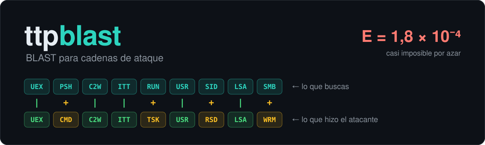
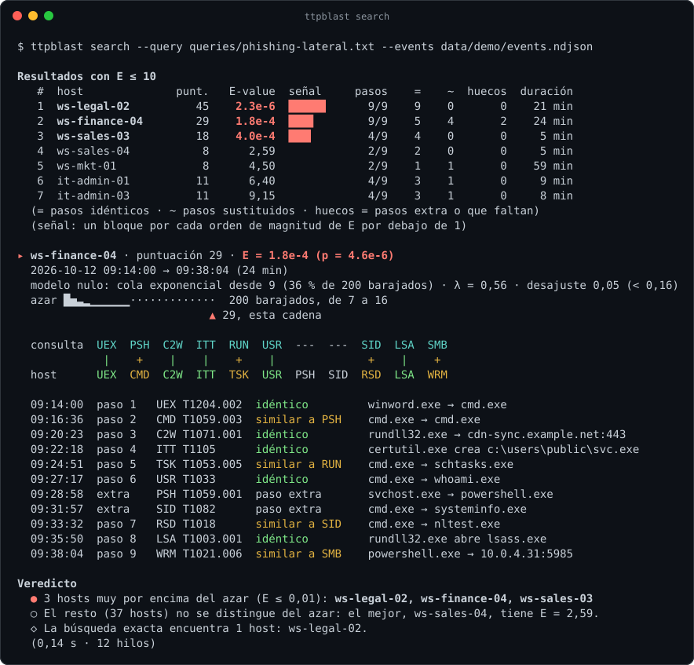
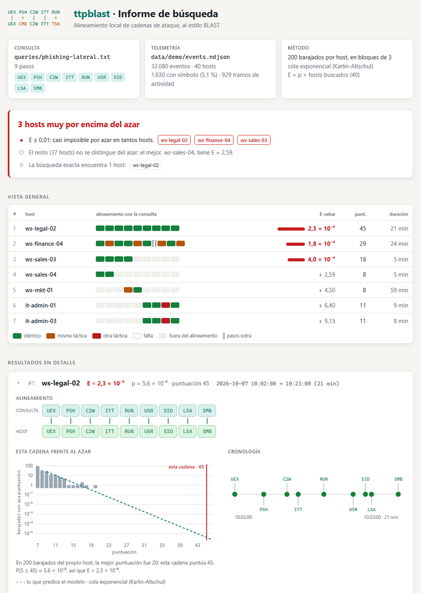

<p align="center">
  
</p>

<p align="center">
  <b>BLAST para la telemetría de endpoint.</b><br>
  Busca <b>variantes</b> de una cadena de ataque conocida en los eventos de tus máquinas<br>
  y te dice, con un E-value, si el parecido es casualidad.
</p>

<p align="center">
  <a href="https://github.com/Ruby570bocadito/ttpblast/actions/workflows/ci.yml"></a>
  
  
  · <a href="README.en.md">English</a>
</p>

**Estado: demo de investigación (v0.2).** Funciona de principio a fin sobre telemetría
sintética, en español y en inglés, con un informe HTML para compartir. La matriz de
puntuación es inicial (no aprendida de datos), la calibración en datos reales está por
demostrar y ya sabemos cómo esconderle una cadena: lee [Limitaciones](#limitaciones) antes
de fiarte de un E-value.

## Pruébalo en 30 segundos

```bash
ttpblast demo
```

La demo esconde cuatro cadenas de ataque en dos semanas de telemetría inventada (40 hosts,
32.080 eventos), las busca como lo haría un analista y se pone nota frente a la verdad. Esto
es lo que ve al buscar la cadena de un documento de Office malicioso:

<p align="center">
  
</p>

La búsqueda exacta solo encuentra la copia idéntica de la cadena (ws-legal-02). `ttpblast`
encuentra también la variante (ws-finance-04: cmd en vez de PowerShell, tarea programada en
vez de clave Run, WinRM en vez de SMB y dos pasos de más) y la cadena cortada a medias
(ws-sales-03). Las tres quedan muy por encima de todo lo demás: el siguiente host tiene
E = 2,59, que es lo esperable por azar.

## El problema

Para buscar una cadena de ataque en la telemetría hay dos opciones habituales, y ninguna
es buena:

- **Consulta exacta** (pasos concretos, en orden). Basta con que el atacante cambie
  PowerShell por cmd, use una tarea programada en lugar de la clave Run o meta un paso de
  más para que la consulta ya no coincida.
- **Consulta relajada** (algunos pasos, en cualquier orden). Aparecen falsas alarmas, y no
  hay forma de saber si "5 de 9 pasos" en este host es raro o es lo normal.

La bioinformática resolvió ese mismo problema hace décadas para el ADN y las proteínas: el
**alineamiento local** tolera sustituciones y huecos, y la **estadística de Karlin-Altschul**
dice cuántos aciertos así esperarías por azar (el E-value de BLAST). `ttpblast` aplica las
dos ideas a la telemetría de endpoint: cada host tiene su «genoma» de técnicas de ATT&CK, y
una consulta es una cadena que se alinea contra todos.

## Inicio rápido

Las versiones etiquetadas publican binarios para Windows, Linux y macOS en
[Releases](https://github.com/Ruby570bocadito/ttpblast/releases): no hace falta nada más,
las consultas de la demo van dentro. Para compilarlo hace falta Rust (edición 2024), que se
instala desde [rustup.rs](https://rustup.rs); en Windows, el instalador pide además las
herramientas de compilación de C++ de Visual Studio. La única dependencia es `serde_json`.

```bash
git clone https://github.com/Ruby570bocadito/ttpblast && cd ttpblast
./demo.sh                 # Linux, macOS o WSL; en Windows: demo (cmd) o .\demo.cmd (PowerShell)
```

```bash
ttpblast demo                                      # demo guiada: telemetría sintética, dos búsquedas y su nota
ttpblast search --query queries/phishing-lateral.txt --events data/demo/events.ndjson
ttpblast hunt --events data/demo/events.ndjson     # las 8 consultas de la biblioteca de una vez
ttpblast hunt --events registros/                  # una carpeta de .evtx o NDJSON, tal cual
ttpblast search ... --html informe.html            # informe visual: un solo fichero, sin conexiones externas
ttpblast search ... --json                         # para scripts y otras herramientas
ttpblast search ... --lang en                      # en inglés (también TTPBLAST_LANG=en)
ttpblast encode --events data/demo/events.ndjson --host ws-finance-04   # el "genoma" de un host
ttpblast alphabet                                  # los 31 símbolos
ttpblast help search                               # todas las opciones de una orden
```

La salida usa colores en una terminal (y nunca en un fichero o una tubería; `NO_COLOR` y
`--color` mandan) y habla el idioma del sistema: español o inglés.

## El informe HTML

`--html FICHERO` escribe, además, un informe autocontenido para abrir en el navegador,
guardar con el caso o adjuntar a un ticket: un solo fichero, sin conexiones externas, con
modo claro y oscuro.

<p align="center">
  
</p>

- **Veredicto** en una frase, con los hosts que se alejan del azar.
- **Vista general** al estilo BLAST: cada paso de la consulta, coloreado según lo que
  encontró en cada host (idéntico, misma táctica, otra táctica, falta).
- **La cadena frente al azar:** las puntuaciones de los barajados del propio host en escala
  logarítmica, la cola exponencial ajustada (una recta en esa escala) y dónde cae la cadena
  real. Es el E-value hecho dibujo.
- **Cronología y pruebas:** cada paso con su hora y el evento que lo respalda.
- La telemetría la puede manipular un atacante (una ruta de fichero puede decir
  cualquier cosa), así que los datos van escapados y la página solo los escribe como texto.
  Hay un test que lo comprueba.

## Biblioteca de consultas

| Consulta | La historia | En la demo |
|---|---|---|
| [`phishing-lateral`](queries/phishing-lateral.txt) | Documento de Office → PowerShell → descarga → clave Run → descubrimiento → LSASS → SMB | exacta, variante y parcial |
| [`exfiltracion`](queries/exfiltracion.txt) | ¿Quién soy? → cuentas → máquinas → comprimir → subir con rclone | un viernes a las 17:31 en ws-hr-02 |
| [`ransomware-preludio`](queries/ransomware-preludio.txt) | nltest → net group → LSASS → PsExec → Defender → copias de sombra → registros | nada: para datos reales |
| [`credenciales-rdp`](queries/credenciales-rdp.txt) | ¿Quién soy? → cuentas → máquinas → LSASS → escritorio remoto | se parece a trozos de tres cadenas |
| [`psexec-destino`](queries/psexec-destino.txt) | servicio nuevo → PsExec lanza un intérprete → reconocimiento, visto desde el destino | nada |
| [`lolbins-persistencia`](queries/lolbins-persistencia.txt) | mshta o regsvr32 → conexión → ejecutable en disco → BITS → clave Run | se parece a dos cadenas |
| [`ntds-robo`](queries/ntds-robo.txt) | cuentas → copia de sombra → ntdsutil → comprimir → subir | nada |
| [`acceso-remoto`](queries/acceso-remoto.txt) | ¿Quién soy? → sistema → Defender → AnyDesk o similar → servicio | nada |

Una consulta es una lista de códigos de símbolo o IDs de técnica, en orden, con
comentarios `#`. Escribir la tuya es copiar una y cambiar las líneas.

**`ttpblast hunt` pasa todas de una vez** por la misma telemetría, leída una sola vez, y da
un veredicto por consulta: la vista de triaje antes de mirar ninguna en detalle. Los hosts
que señalan varias consultas salen aparte. En la demo son justo los cuatro atacados,
porque las consultas emparentadas encajan en trozos de sus cadenas:

```text
ttpblast hunt · 8 consultas contra data/demo/events.ndjson
32.080 eventos · 40 hosts · 0,68 s

  ● phishing-lateral      3 hosts muy por encima del azar  ws-legal-02 2.3e-6 · ws-finance-04 1.8e-4 · ws-sales-03 4.0e-4
  ● exfiltracion          1 host muy por encima del azar   ws-hr-02 6.4e-3
  ○ ransomware-preludio   nada se aleja del azar           (el mejor, ws-ops-02, tiene E = 1,40)
  ◐ credenciales-rdp      4 hosts a revisar                ws-finance-04 0,03 · ws-hr-02 0,41 · ws-legal-02 0,52 · it-admin-02 0,60
  ...

Hosts que señalan varias consultas (lo primero que miraría):
  ◆ ws-finance-04: phishing-lateral, credenciales-rdp
  ◆ ws-hr-02: exfiltracion, credenciales-rdp
  ◆ ws-legal-02: phishing-lateral, credenciales-rdp, lolbins-persistencia
  ◆ ws-sales-03: phishing-lateral, lolbins-persistencia
```

Con ocho consultas, algún «a revisar» suelto en un administrador (E entre 0,1 y 1) es lo
esperable por azar. `--json` da lo mismo para scripts y `--html CARPETA`, un informe por
consulta.

**Cada host se compara consigo mismo.** La consulta de exfiltración tiene una trampa:
srv-backup-01 comprime y sube copias con rclone todas las noches. Su parecido con la
consulta (puntuación 12) es mayor que el del segundo de la tabla, pero para ese host es lo
normal: E = 40. El portátil de recursos humanos que hace lo mismo un viernes por la tarde,
después de mirar cuentas y máquinas, sale con E = 6,4·10⁻³.

## Con tu propia telemetría

`--events` acepta un fichero `.evtx` de Windows, un NDJSON o una carpeta con varios de
ellos (por ejemplo, los registros recogidos de varios equipos en una respuesta a
incidentes). Los `.evtx` se leen directamente, sin dependencias y sin pasar por PowerShell.
El lector da exactamente lo mismo que el de Windows (`Get-WinEvent`) en 8.240 registros
reales de cuatro registros distintos, y un test lo compara con cualquier `.evtx` que le
des (ver [CONTRIBUTING](CONTRIBUTING.md)). Un fichero dañado o manipulado no lo tumba: los
registros ilegibles se saltan y se cuentan.

### Con Sysmon

[Sysmon](https://learn.microsoft.com/es-es/sysinternals/downloads/sysmon) es una
herramienta gratuita de Microsoft Sysinternals que registra lo que pasa en el equipo
(procesos, conexiones, ficheros, registro). La versión actual funciona en Windows 11 o
posterior y en Windows Server 2019 o posterior.

En una PowerShell abierta **como administrador**, instálalo con la configuración de
[SwiftOnSecurity](https://github.com/SwiftOnSecurity/sysmon-config):

```powershell
$ProgressPreference = 'SilentlyContinue'
New-Item -ItemType Directory -Force C:\Tools\Sysmon | Out-Null
Invoke-WebRequest https://download.sysinternals.com/files/Sysmon.zip -OutFile C:\Tools\Sysmon\Sysmon.zip
Expand-Archive C:\Tools\Sysmon\Sysmon.zip -DestinationPath C:\Tools\Sysmon -Force
Invoke-WebRequest https://raw.githubusercontent.com/SwiftOnSecurity/sysmon-config/master/sysmonconfig-export.xml -OutFile C:\Tools\Sysmon\sysmonconfig.xml
C:\Tools\Sysmon\Sysmon64.exe -accepteula -i C:\Tools\Sysmon\sysmonconfig.xml
```

Usa el equipo con normalidad unos días. Después, desde la carpeta de `ttpblast` (y también
como administrador):

```powershell
cargo build --release
powershell -ExecutionPolicy Bypass -File .\scripts\export-sysmon.ps1 -Days 7
.\target\release\ttpblast.exe encode --events data\sysmon\events.ndjson --unmatched 15
.\target\release\ttpblast.exe search --query queries\phishing-lateral.txt --events data\sysmon\events.ndjson --html data\sysmon\informe.html
```

O, sin el script, con el registro entero tal cual (también como administrador):

```powershell
New-Item -ItemType Directory -Force data\evtx | Out-Null
wevtutil epl Microsoft-Windows-Sysmon/Operational data\evtx\sysmon.evtx
.\target\release\ttpblast.exe hunt --events data\evtx --html data\evtx\informes
```

- **Privacidad.** [`scripts/export-sysmon.ps1`](scripts/export-sysmon.ps1) solo exporta
  rutas de procesos, ficheros y claves de registro, y destinos de red. No exporta líneas
  de comandos, usuarios ni hashes. El resultado queda en `data\`, que git ignora.
  Tampoco exporta los eventos de sus propias ejecuciones (la de ahora y las anteriores),
  para no contaminar la medición. El `.evtx` entero, en cambio, sí lleva líneas de
  comandos, usuarios y hashes: ttpblast no los usa, pero no lo compartas sin mirarlo.
- **Otros formatos.** También se leen los eventos de Sysmon enviados por Winlogbeat 6 o 7
  y las exportaciones planas con los campos de Sysmon en la raíz (`EventID`, `Hostname`,
  `Image`…), el formato de los Security Datasets de OTRF. Y cualquier NDJSON con campos al
  estilo ECS (ver [Formatos](#formatos)).
- **Qué esperar.** En un equipo limpio, lo normal es que ningún resultado tenga un E-value
  pequeño. Si alguno lo tiene, es una falsa alarma que merece la pena mirar: es justo lo que
  hay que medir.
- **Un solo equipo.** Con un único host, `E = p`.
- **Accesos a procesos.** La configuración de SwiftOnSecurity no registra accesos a otros
  procesos (evento 10), así que el paso `LSA` nunca aparecerá.
- **Conexiones.** Solo se traducen las conexiones salientes.
- **Espacio.** Sysmon escribe en el registro de eventos, que tiene un tamaño máximo; si se
  llena, se pierden los eventos más antiguos.
- **Desinstalar.** `C:\Tools\Sysmon\Sysmon64.exe -u`.

### Sin Sysmon: los registros de Windows

Muchos equipos no tienen Sysmon, pero Windows ya registra parte de lo mismo si se activa su
auditoría. ttpblast traduce:

| Registro | Evento | Qué es | Para qué símbolos |
|---|---|---|---|
| Seguridad | 4688 | proceso creado (con su padre desde Windows 10) | casi todos: PSH, CMD, USR, SID, TSK, UEX… |
| Seguridad | 4657 | valor del registro escrito (con una SACL en la clave) | RUN, SVC, DEF |
| Seguridad | 5156 | conexión permitida por el firewall (solo salientes) | SMB, WRM, RDP, C2W, EXF |
| Sistema | 7045 | servicio instalado | SVC |

Para la creación de procesos, en una PowerShell como administrador (el GUID es la
subcategoría «Creación de procesos», con cualquier idioma de Windows):

```powershell
auditpol /set /subcategory:"{0CCE922B-69AE-11D9-BED3-505054503030}" /success:enable
# … días después:
New-Item -ItemType Directory -Force data\evtx | Out-Null
wevtutil epl Security data\evtx\security.evtx
wevtutil epl System data\evtx\system.evtx
.\target\release\ttpblast.exe hunt --events data\evtx
```

El laboratorio de la CI lo comprueba en una máquina real: `whoami`, `hostname` y `schtasks`
salen codificados igual desde el registro de Seguridad que desde Sysmon. Los accesos a
LSASS no tienen equivalente sin Sysmon, así que el paso `LSA` no aparecerá.

## Cómo funciona

1. **Alfabeto.** Cada evento relevante se convierte en un símbolo, una técnica de MITRE
   ATT&CK (`PSH` = T1059.001 PowerShell, `LSA` = T1003.001 acceso a LSASS…). Hay 31, con
   nombre en español y en inglés; las reglas están en
   [`alphabet/default.json`](alphabet/default.json), con sintaxis al estilo Sigma
   (`campo`, `campo|contains`, `campo|endswith`). Solo miran nombres de procesos, rutas y
   destinos de red, nunca líneas de comandos. En la demo, el 95 % de los eventos no encaja
   con ninguna regla y se descarta.
2. **Secuencias.** Una por host, ordenada en el tiempo y cortada en tramos cuando pasa más
   de una hora sin actividad (`--max-gap`), para que una cadena no tome prestado un paso
   del día siguiente.
3. **Puntuación.**
   - Un paso idéntico puntúa según lo raro que es el símbolo en los datos: `log2(1/q)`,
     redondeado y acotado a 3–10, donde `q` es su frecuencia. Acertar un acceso a LSASS
     pesa más que acertar un PowerShell.
   - Una sustitución dentro de la misma táctica puntúa +2; entre tácticas distintas, −3.
   - Un hueco cuesta −4, y −1 por cada paso más. Los pasos que faltan y los pasos de más
     pueden costar distinto (`--gap-open`/`--gap-extend` y `--extra-open`/`--extra-extend`).
4. **Alineamiento local** de la consulta contra cada tramo: Smith-Waterman con huecos
   afines (variante de Gotoh), con *traceback* para enseñar qué paso corresponde a qué
   evento. Los hosts se reparten entre todos los núcleos, con el mismo resultado que con
   uno solo.
5. **Significación.**
   - Se barajan 200 veces los símbolos del propio host, manteniendo la longitud de los
     tramos, y se alinea la consulta contra cada barajado.
   - Se baraja por bloques de 3 símbolos (`--block`), para conservar las ráfagas de
     actividad. La región del mejor alineamiento, en cambio, se baraja símbolo a símbolo:
     así la propia cadena no queda entera, en trozos, dentro de su modelo de azar.
   - A la cola de esas puntuaciones se le ajusta una exponencial (la forma de
     Karlin-Altschul): `P(S ≥ s) ≈ P(S ≥ u) · e^(−λ(s−u))`, donde `u` es el umbral de la
     cola (justo por encima de la mediana) y `λ` la tasa de caída.
   - `E = p × número de hosts` es el número de hosts que esperarías ver con una
     puntuación así por puro azar.
   - Cada host se compara consigo mismo: un administrador hace descubrimiento todo el día,
     así que sus parecidos parciales no sorprenden; en un portátil de ventas, sí.
   - La salida enseña el diagnóstico del ajuste (si la cola no parece exponencial, lo marca
     con ⚠) y, en dos líneas, dónde cae la cadena entre los barajados.

## Resultados en datos sintéticos

La demo genera 40 hosts Windows durante 14 días (32.080 eventos). Incluye actividad
rutinaria, tres administradores cuyo trabajo diario se parece a trozos de una intrusión, un
servidor de copias que comprime y sube datos cada noche, y cuatro cadenas inyectadas.
`truth.json` guarda la verdad para evaluar, y `ttpblast demo` se evalúa con ella.

| Escenario | Consulta | Qué cambia respecto a la consulta | Búsqueda exacta | ttpblast |
|---|---|---|---|---|
| `exacta` | phishing-lateral | nada | sí | puesto 1, E = 2,3·10⁻⁶ |
| `variante` | phishing-lateral | 4 técnicas sustituidas y 2 pasos de más | no | puesto 2, E = 1,8·10⁻⁴ |
| `parcial` | phishing-lateral | solo los 4 primeros pasos | no | puesto 3, E = 4,0·10⁻⁴ |
| `exfiltración` | exfiltracion | nada, pero el servidor de copias hace los dos últimos pasos cada noche | sí | puesto 1, E = 6,4·10⁻³ |

**Calibración** (`python experiments/calibracion.py --seeds 20`, y `--extra="--block 1"`
para las otras filas): 20 conjuntos de datos con semillas distintas, las dos consultas de la
demo, 36 hosts benignos (sin ninguna cadena) en cada búsqueda; 1.440 búsquedas de hosts
benignos en total. Si los E-values estuvieran bien calibrados, ~36 tendrían E ≤ 1 y ~3,6,
E ≤ 0,1. Cada celda de las cadenas es su E mediano y, entre paréntesis, en cuántos de los 20
conjuntos sale con E ≤ 0,01.

| Barajado | Modelo nulo | Benignos E ≤ 1 | Benignos E ≤ 0,1 | Exacta | Variante | Parcial | Exfiltración |
|---|---|---|---|---|---|---|---|
| bloques de 3 (por defecto) | `cola` (por defecto) | 12 | 0 | 1,4·10⁻⁶ (20) | 4,0·10⁻⁴ (19) | 2,1·10⁻² (8) | 2,0·10⁻³ (18) |
| bloques de 3 (por defecto) | `gumbel` | 30 | 1 | 4,0·10⁻⁹ (20) | 2,0·10⁻⁵ (19) | 2,0·10⁻³ (16) | 7,4·10⁻⁷ (20) |
| bloques de 1 | `cola` | 13 | 0 | 7,1·10⁻⁶ (20) | 1,1·10⁻³ (16) | 2,1·10⁻² (5) | 5,3·10⁻⁴ (19) |
| bloques de 1 | `gumbel` | 19 | 5 | 1,9·10⁻⁸ (20) | 5,4·10⁻⁵ (20) | 8,9·10⁻⁴ (18) | 3,3·10⁻⁸ (20) |

- Con el modelo por defecto, las cuatro cadenas quedan entre los 3 primeros puestos en los
  20 conjuntos (la de exfiltración, siempre la primera); con la Gumbel, entre los 4.
- **La cola exponencial es conservadora:** da menos falsas alarmas de las que promete. La
  Gumbel con bloques de 3 queda cerca de lo calibrado; con bloques de 1 se pasa un poco en
  la cola (5 con E ≤ 0,1 de ~3,6 esperados).
  - La cola sigue por defecto porque se equivoca hacia el lado seguro y describe mejor la
    forma de la cola que se observa. La Gumbel completa no modela el "suelo" que se forma
    cuando un símbolo raro aparece en todos los barajados.
  - Con telemetría real habrá que volver a elegir.
- **Lo que se probó y no funcionó:**
  - *Bloques de 3 sin desordenar la región alineada.* La cadena queda en trozos dentro de
    su propio modelo de azar y se penaliza: la E mediana de la exacta subía a 4·10⁻² con la
    cola (medido en la v0.1).
  - *Excluir la región alineada del barajado.* 135 hosts benignos con E ≤ 1, de ~18,5
    esperados (v0.1). Al quitarle a cualquier host su mejor región, su modelo de azar se
    queda sin los símbolos con los que se forma la puntuación, y todo parece significativo.
- **En Windows real.** El flujo [`Sysmon lab`](.github/workflows/sysmon-lab.yml) instala
  Sysmon en una máquina Windows desechable de GitHub con los comandos de este README. Genera
  actividad benigna (compilar, `whoami`, `hostname`, `systeminfo`, `schtasks`, `net user`,
  `ipconfig`, `tasklist`, una descarga desde PowerShell), exporta con el script y analiza.
  - Primera ejecución (v0.1): 46 eventos, 6 con símbolo (`PSH ACD SID SID TSK C2W`; desde la
    v0.2, `whoami` es `USR`), justo los comandos lanzados.
  - El mejor parecido con la cadena tuvo E = 0,54: ninguna falsa alarma, aunque esos
    comandos se parecen al descubrimiento de una intrusión.
  - Comprueba la cadena de Sysmon de principio a fin. No mide la calibración: son unos
    minutos de actividad de una máquina de compilación.
- **Esto demuestra que el mecanismo funciona, no que funcione en tu red.** Los datos los
  genera el propio proyecto, con el mismo alfabeto que luego los busca, y la actividad
  benigna sintética es más aleatoria que la real.

## Cuánto cuesta esconderse

Quien conozca el método puede intercalar comandos corrientes (cmd, schtasks, ipconfig…)
entre los pasos de su cadena. `ttpblast synth --padding N` mete N entre cada dos pasos de
cada cadena inyectada, y [`experiments/evasion.py`](experiments/evasion.py) mide qué queda:
20 semillas, 80 cadenas por fila.

| Relleno entre pasos | Costes por defecto: cadenas con E ≤ 0,01 | E mediano de la exacta | Pasos de más gratis (`--extra-open 0`) | E mediano de la exacta |
|---|---|---|---|---|
| 0 | 65/80 | 1,4·10⁻⁶ | 58/80 | 9,0·10⁻⁵ |
| 1 | **0/80** | 0,89 | 18/80 | 4,8·10⁻³ |
| 2 | 0/80 | 20 | 5/80 | 1,6·10⁻² |
| 3 | 0/80 | 26 | 2/80 | 3,5·10⁻² |
| 4 | 0/80 | 29 | 0/80 | 7,0·10⁻² |

- **Basta un comando intercalado entre cada dos pasos para esconder las cuatro cadenas.**
  Con los costes por defecto, cada uno abre un hueco (−4) o se empareja mal, y la
  puntuación se hunde: en la demo, la exacta pasa de 45 a 18.
- Abaratar los pasos de más ayuda poco y cuesta detección sin relleno (58/80 frente a
  65/80). Si los pasos de más son gratis, la puntuación se mantiene, pero sube la del azar:
  la ventana de la cadena es más larga y, en los barajados, una ventana larga encuentra los
  símbolos de la consulta en un orden parecido con más facilidad.
- Las falsas alarmas no cambian (0,34 hosts benignos con E ≤ 1 de cada 40, frente a ~1 si
  estuviera calibrado): el relleno solo toca los hosts atacados.
- Es el mismo problema que las regiones de baja complejidad en BLAST, que se enmascaran
  (SEG, DUST) antes de alinear. Aquí el equivalente sería enmascarar la rutina de cada host;
  está en la [hoja de ruta](#hoja-de-ruta). Mientras tanto, `ttpblast` sirve contra
  cadenas que varían sin intentar esconderse de él, no contra un adversario que lo conoce.

## Comparación honesta

| | ttpblast | Consulta de secuencia exacta (p. ej. `sequence` de EQL) |
|---|---|---|
| Variantes (técnica sustituida, paso extra o que falta) | sí | no |
| ¿Es raro este parecido en este host? | E-value por host | no lo dice |
| Relleno deliberado entre pasos | lo esconde con un solo comando | no le afecta si cabe en `maxspan` |
| Coste | alineamiento + 200 barajados por host (~0,15 s en la demo, con todos los núcleos) | muy bajo |
| Madurez | demo de investigación | herramientas maduras en producción |
| Explicación | alineamiento paso a paso con sus eventos e informe HTML | eventos que coinciden |

No sustituye a las reglas exactas: sirve para cazar (*hunting*) variantes de cadenas
conocidas y para priorizar.

## Limitaciones

- **Solo se ha probado con datos sintéticos.** La pregunta abierta número uno es si los
  E-values siguen calibrados con telemetría real.
- **Se esconde con relleno.** Un comando corriente entre cada dos pasos basta para que una
  cadena no destaque (ver [Cuánto cuesta esconderse](#cuánto-cuesta-esconderse)).
- **La matriz de puntuación es a mano:** rareza del símbolo más una regla por tácticas. La
  idea de fondo es aprenderla de cadenas reales, como se aprendió BLOSUM de bloques de
  proteínas.
- **Sin líneas de comandos.** Las reglas solo ven nombres de procesos y rutas: `net.exe`
  cuenta entero como descubrimiento de cuentas y `vssadmin.exe` como herramienta de copias
  de sombra, se usen para lo que se usen.
- **Barajar destruye parte de la estructura temporal.** Los bloques de 3 conservan las
  ráfagas cortas. Si la actividad real tiene una estructura más larga, el modelo de azar
  será demasiado aleatorio y los E-values saldrán optimistas. Hay que medirlo con datos
  reales. Usar hosts parecidos como referencia está en la hoja de ruta.
- **Los tramos usan un hueco de tiempo fijo.** Una cadena lenta, con horas entre pasos, se
  corta (`--max-gap` lo ajusta). Además, el alineamiento no usa los tiempos dentro de un
  tramo.
- **Un host cada vez.** No sigue el movimiento lateral de un host a otro.
- **El alineamiento es el óptimo según la puntuación,** no siempre el que elegiría una
  persona. En la variante de arriba empareja SID con RSD y deja el SID real como paso
  extra, porque los huecos afines prefieren un hueco largo a dos cortos.
- **Escala.** El coste es O(m·n) por tramo, más los barajados, repartido entre los núcleos.
  Para millones de eventos hará falta un índice de semillas, como hace BLAST.
- **Formato de entrada.** `.evtx` o NDJSON con campos al estilo ECS. El acceso a procesos
  usa `process.target.name`, que no es estándar. Sysmon (en `.evtx`, exportado con el
  script, por Winlogbeat 6 o 7, o plano como en OTRF) y los eventos 4688, 4657, 5156 y 7045
  de Windows se traducen solos; otras fuentes (Linux, EDR) necesitan mapear campos o un
  adaptador.

## Hoja de ruta

1. Probar el alfabeto con datos públicos de ataques simulados (Security Datasets de OTRF,
   que ya se leen): ¿se alinean dos ejecuciones del mismo escenario mejor que con el ruido?
2. **Enmascarar la rutina** de cada host antes de alinear, como SEG y DUST hacen con las
   regiones de baja complejidad, y volver a medir el coste de evasión.
3. Aprender la matriz de sustitución de cadenas reales.
4. Calibración con telemetría real, y decidir el modelo nulo: cola o Gumbel, tamaño de
   bloque, hosts parecidos como referencia.
5. Más fuentes de entrada: salidas NDJSON de EDR abiertos y telemetría de Linux.
6. Índice de semillas (k-mers) para volúmenes grandes.
7. Huecos que dependan del tiempo, y cadenas entre hosts.

Hecho: medir el coste de evasión (y el resultado está arriba), leer Winlogbeat 6 y el
formato plano de OTRF (v0.2); leer `.evtx` directamente, los registros de Windows sin
Sysmon y carpetas enteras, y pasar toda la biblioteca con `hunt` (sin publicar). El
detalle, en el [CHANGELOG](CHANGELOG.md).

## Formatos

- **Eventos:** un JSON por línea, o ficheros `.evtx` de Windows (se distinguen por sus
  primeros bytes, no por la extensión), o una carpeta, de la que se leen los `.evtx`,
  `.ndjson`, `.jsonl` y `.json`. En JSON, los objetos anidados y las claves con puntos son
  equivalentes, y los valores se comparan sin distinguir mayúsculas. El host sale de
  `host.name` (o `host.hostname`, `agent.hostname`, `winlog.computer_name`,
  `computer_name`, `Hostname`) y la hora de `@timestamp` (o `timestamp`, `UtcTime`).
  Campos que usan las reglas: `process.name`, `process.parent.name`,
  `process.target.name`, `destination.port`, `destination.address`, `file.path`,
  `file.extension`, `registry.path`, `event.category` y `event.action`. Un registro de un
  `.evtx` da `EventID`, `Channel`, `EventRecordID`, `SourceName` (el proveedor),
  `Hostname`, `@timestamp`, el resto de `System` como `System.*` y cada valor de
  `EventData` por su nombre.
- **Consultas:** códigos de símbolo o IDs de técnica, separados por espacios, comas o
  flechas; `#` inicia un comentario. Ver [`queries/`](queries/).
- **Alfabeto:** JSON con `symbols`. Cada símbolo tiene `code`, `technique`, `tactic`,
  `name` (un texto, o uno por idioma: `{"es": …, "en": …}`) y una lista `rules`. Gana el
  primer símbolo que encaja. Se carga otro con `--alphabet`.
- **Salida JSON** (`--json`): la consulta, la telemetría, los ajustes, el veredicto
  (`summary`), cada resultado con su alineamiento, sus pruebas y el histograma de sus
  barajados, y la línea base exacta. `hunt --json` da, por consulta, los hosts muy por
  encima del azar (`strong`), los que merecen otra mirada (`weak`) y el mejor, y aparte
  los hosts que señalan varias consultas (`repeated`).

## Contribuir

Ideas, datos reales (anonimizados) que pongan a prueba la calibración y nuevas consultas son
especialmente bienvenidas. [CONTRIBUTING.md](CONTRIBUTING.md) explica cómo añadir un
símbolo o una consulta y cómo comprobar que nada se rompe.

## Uso responsable

Es una herramienta defensiva: busca en tu propia telemetría. Los datos sintéticos de la
demo son eventos inventados con dominios de ejemplo (`*.example.*`) y direcciones privadas.
No contienen código ni muestras de malware. Las consultas describen patrones genéricos que
publican los informes de respuesta a incidentes.

## Licencia

A tu elección, [MIT](LICENSE-MIT) o [Apache-2.0](LICENSE-APACHE), como es habitual en Rust.
Salvo que digas lo contrario, cualquier contribución que envíes para incluirla en el
proyecto se licencia de esa misma doble forma, sin condiciones adicionales.
